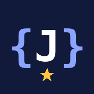

<div align="center">



# Java Quest

**Learn Java by playing. Short lessons, then a quiz that fights back.**


[Install](#install) · [Features](#features) · [Deploy your own](#deploy-your-own) · [Customize](#customize)

</div>

---

## Features

- **7 lessons** that start from zero: variables, operators, decisions, loops, methods, arrays, and classes.
- **112 challenges**: 84 multiple choice questions and 28 coding challenges where you type the Java yourself.
- **4 difficulty modes**, from forgiving to brutal.
- **Progress that sticks**: stars per lesson and mode, XP, and levels, saved on your device.
- **Made for phones**: one question per screen, big tap targets, light and dark themes.
- **A proper first launch**: an animated splash screen, then a short welcome tour for new players.
- **Works offline** after the first visit.
- **Private**: no accounts, no tracking, nothing leaves your device.

### Difficulty modes

| Mode | How it plays | Lives | XP per correct answer |
| --- | --- | --- | --- |
| **Easy** | Multiple choice. A hint removes two wrong answers. | Unlimited | 10 |
| **Medium** | Multiple choice. No hints. | 3 hearts | 20 |
| **Hard** | Multiple choice with a 20 second timer. | 2 hearts | 30 |
| **Extreme** | Write the code yourself. No options to pick from. | 3 hearts | 40 |

Every lesson has 4 questions per mode. Stars: 4 correct earns 3 stars, 3 correct earns 2, and 2 correct earns 1. A perfect run adds a bonus. You level up every 150 XP.

### Lessons

| # | Lesson | You will learn |
| --- | --- | --- |
| 1 | Variables & Types | `int`, `double`, `boolean`, `char`, `String`, `final` |
| 2 | Operators & Math | arithmetic, `%`, comparisons, `&&` `\|\|` `!`, `++` |
| 3 | Decisions | `if` / `else`, ternary, `switch` |
| 4 | Loops | `for`, `while`, `do-while`, `break`, `continue` |
| 5 | Methods | parameters, `return`, `void`, overloading, recursion |
| 6 | Arrays & ArrayList | indexes, `length`, `add`, `get`, for-each |
| 7 | Classes & Objects | constructors, `private`, `this`, `extends`, `static` |

### How Extreme mode checks your code

The app does not run your Java. It reads what you typed and checks it against the pattern each challenge expects. Spacing, line breaks and comments do not matter. Spelling, semicolons, brackets and the names the task gives you do. Mismatched brackets and unclosed quotes get a message and cost nothing. After you answer, you see your code next to one example solution.

---

## Install

| Where | How |
| --- | --- |
| **Android app** | Download `java-quest.apk` from the [latest release](../../releases/latest), open it, and allow installs from unknown sources. |
| **iPhone** | Open the web link in Safari, tap **Share**, then **Add to Home Screen**. |
| **Android browser** | Open the web link in Chrome, tap the menu, then **Install app**. |
| **Any computer** | Open the web link in a browser. |

The web link is `https://YOUR-USERNAME.github.io/java-quest/` once you [deploy your own](#deploy-your-own).

---

## Deploy your own

You need a free GitHub account. No Git knowledge needed.

### 1. Create the repository

<details>
<summary>Step by step</summary>

1. Sign in at github.com, tap **New repository**, name it `java-quest`, keep it **Public**, and create it.
2. Tap **uploading an existing file** (or **Add file > Upload files**).
3. Unzip the download. Open the unzipped folder and upload what is inside it, including the `icons` folder. The files must sit at the top level of the repo, not inside another folder.
4. Tap **Commit changes**.

With Git instead:

```bash
cd java-quest
git init
git add .
git commit -m "Java Quest"
git branch -M main
git remote add origin https://github.com/YOUR-USERNAME/java-quest.git
git push -u origin main
```

</details>

### 2. Turn on the web version

<details>
<summary>Step by step</summary>

1. In the repo, open **Settings > Pages**.
2. Set **Source** to **Deploy from a branch**.
3. Pick branch **main** and folder **/ (root)**, then **Save**.
4. After a minute the app is live at `https://YOUR-USERNAME.github.io/java-quest/`.

</details>

### 3. Build the Android app

<details>
<summary>Step by step</summary>

The workflow in `.github/workflows/build-apk.yml` builds an Android app with [Capacitor](https://capacitorjs.com) and publishes it as a release. It runs every time you push to `main`.

If the `.github` folder did not upload (hidden folders are often skipped), add it by hand:

1. Tap **Add file > Create new file**.
2. In the name box, type `.github/workflows/build-apk.yml`. Typing the slashes creates the folders.
3. Paste in the contents of `build-apk.yml` from the download and commit.

Then:

1. Open the **Actions** tab, pick **Build Java Quest APK**, and tap **Run workflow** (skip this if a run already started).
2. Wait 5 to 10 minutes for the green check.
3. Open **Releases** on the repo home page and download `java-quest.apk` from the newest release.

</details>

### Troubleshooting

| Problem | Fix |
| --- | --- |
| Release step fails with a permissions error | **Settings > Actions > General > Workflow permissions**, then choose **Read and write permissions**. |
| App shows the default Android icon | The optional icon step failed. The app still works. |
| Phone keeps showing an old version | Raise the cache number in `sw.js` (see [Customize](#customize)). |
| APK will not install on iPhone | APKs are Android only. Use **Add to Home Screen** on iPhone. |

---

## Customize

| What | Where |
| --- | --- |
| Lessons and questions | In `index.html`, between `/*DATA*/` and `/*END DATA*/`. For multiple choice, the first option is the correct one. The app shuffles them. |
| Coding challenges | The `EXTREME` list in the same block. Each has a prompt, optional starter code, an example solution, and the patterns the answer must match. |
| Colors and fonts | The variables at the top of the `<style>` block. |
| App name and colors on the phone | `manifest.webmanifest` |
| Icons | `icons/` (the Android build uses `icon-maskable-512.png`) |

After changing `index.html`, open `sw.js` and raise `java-quest-v2` to `java-quest-v3` (then v4, and so on). That makes phones fetch the new version instead of the saved one.

To test on your computer, run `python3 -m http.server` in the project folder and open `http://localhost:8000`.

To start over inside the app, tap **Reset progress** at the bottom of the home screen, then tap it again to confirm.

---

## Project layout

```
java-quest/
├── index.html               the whole app: content, game logic, styles
├── manifest.webmanifest     install details for phones
├── sw.js                    offline support
├── icons/                   app icons
├── .nojekyll                serves the files as they are on GitHub Pages
└── .github/workflows/
    └── build-apk.yml        builds the Android app
```

## Built with

Plain HTML, CSS and JavaScript. No framework, no build step, no dependencies. Fonts come from Google Fonts. Progress is stored in the browser's `localStorage`. The Android app wraps the same files with Capacitor.
